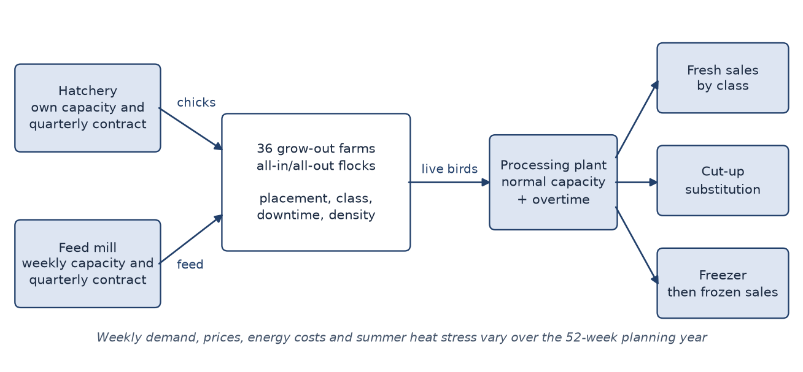
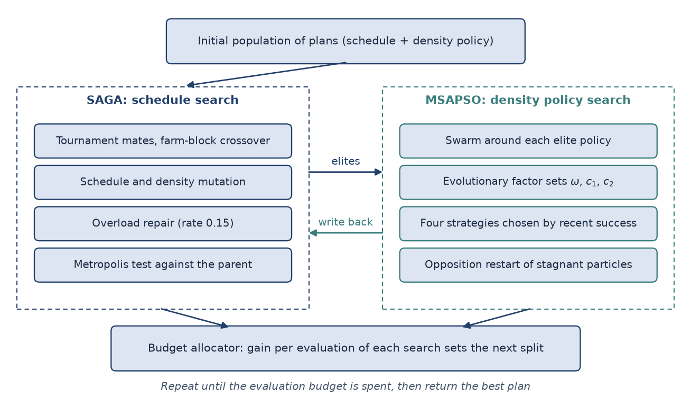
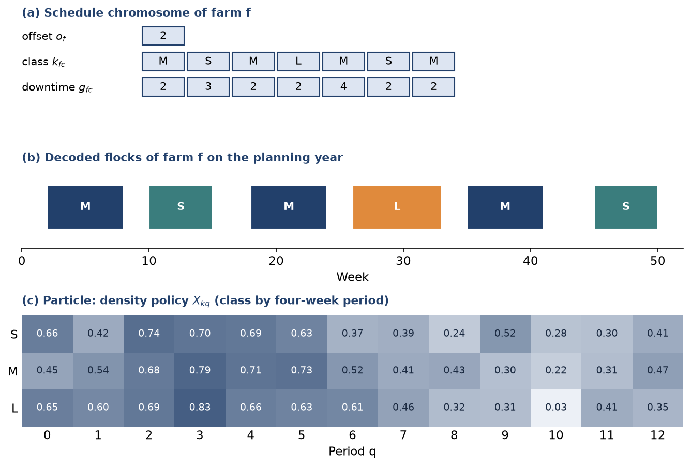
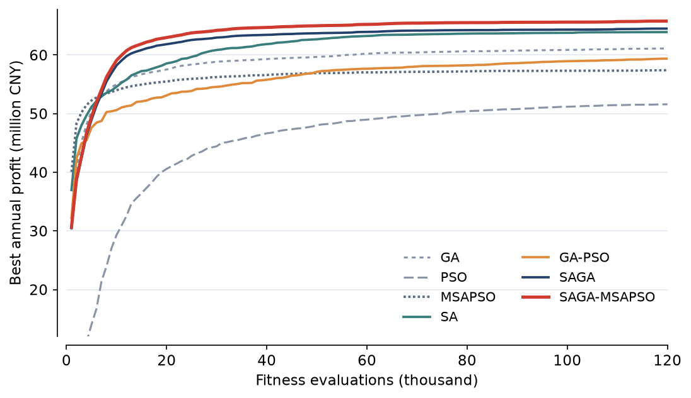
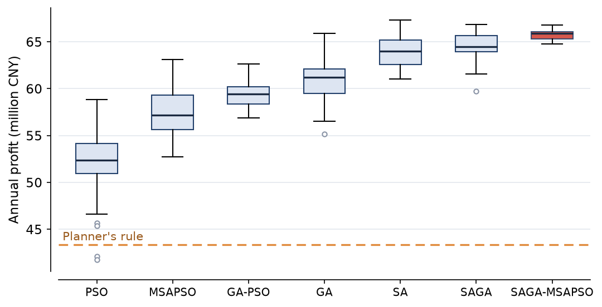
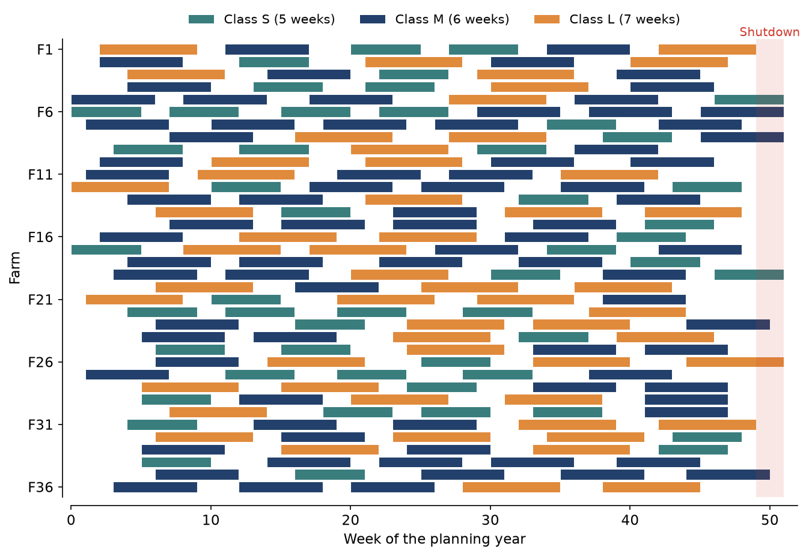
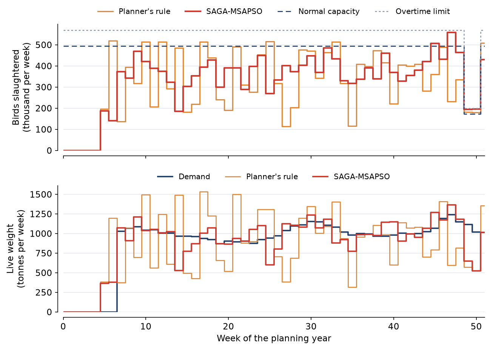
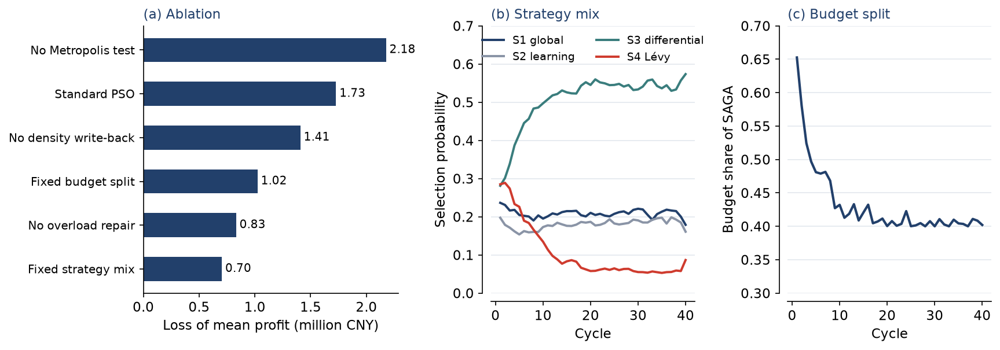
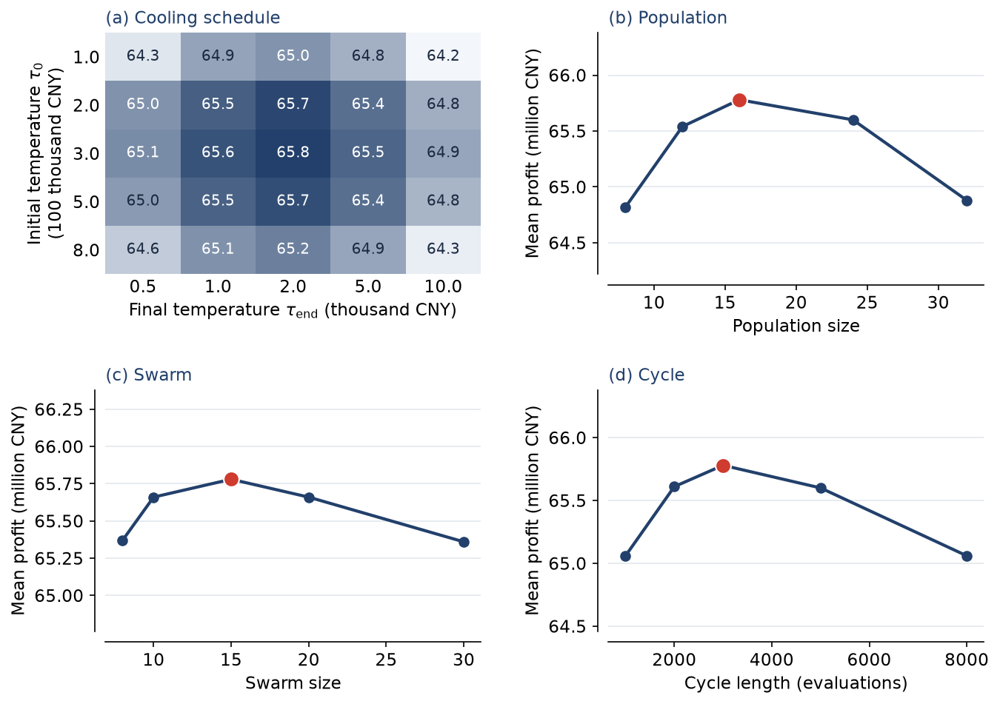

# A Study on Optimization Methods for Poultry Production Planning Combining Simulated Annealing Genetic Algorithms and Multi-Strategy Adaptive Particle Swarm Optimization

Junhao Lin^a^, Xiaoqing Zhao^a,\*^, Mingyu Fang^b^, Ruiqi Deng^a^

^a^ School of Intelligent Agriculture and Information Engineering, Huaihe University of Agricultural Science and Technology, Bengbu 233030, China\
^b^ Planning and Digital Operations Center, Huaiyuan Integrated Poultry Group, Bengbu 233000, China

\* Corresponding author. E-mail address: zhaoxiaoqing@huast.edu.cn (X. Zhao).

**Teaching example: the authors, institutions, dataset and results in this paper are fictional.**

## Abstract

An integrated broiler enterprise has to decide, a year ahead, when each farm places a flock, which market class the flock is grown to, how long the houses stand empty between flocks and how densely they are stocked. These decisions are tied together by the weekly capacity of the hatchery, the feed mill and the processing plant, by quarterly take-or-pay contracts for chicks and feed, and by a demand that peaks just before the Spring Festival, when the capacity of the plant falls sharply. The problem therefore mixes a large combinatorial schedule with a set of continuous stocking decisions, and neither a purely discrete nor a purely continuous search handles both parts well. To address this difficulty, this paper proposes a hybrid method, SAGA-MSAPSO, in which a simulated annealing genetic algorithm searches the schedule, a multi-strategy adaptive particle swarm optimizer searches a seasonal density policy for the best schedules, and the evaluation budget is divided between the two searches according to the profit each has recently gained. The swarm selects among four update strategies by their recent success and adjusts its inertia and acceleration coefficients from an evolutionary factor, while the genetic search accepts offspring through a Metropolis test and repairs overloaded harvest weeks. The method was evaluated on the planning data of a 36-farm enterprise and on two further instances of 12 and 72 farms, with thirty independent runs of 120,000 fitness evaluations for each algorithm. On the 36-farm instance the method reached a mean annual profit of 65.78 million CNY, which is 51.8% above the planner's rule, 2.93% above simulated annealing and 1.98% above the simulated annealing genetic algorithm alone, with a standard deviation of 0.58 million CNY against 1.84 and 1.51 million CNY. The mean service level rose from 93.58% to 98.63%, and in the plan examined in detail the coefficient of variation of the weekly plant load fell from 0.358 to 0.205. The results indicate that assigning each part of a mixed decision to the search suited to it gives a reliable planning tool that an enterprise can run on an ordinary workstation.

*Keywords:* Poultry production planning; Simulated annealing genetic algorithm; Multi-strategy adaptive particle swarm optimization; Hybrid metaheuristic; Stocking density; Take-or-pay contract

## 1. Introduction

Broiler production in China has become larger in scale and increasingly contract-based [1], and integrated enterprises that coordinate breeding, feed, grow-out and processing are a familiar form of organization in the sector. Guo et al. [1] analyzed the Chinese broiler industry for 2017 to 2024 and reported technical efficiency that moved between 0.913 and 0.959 over the period, with an average of 0.939 for contract growers and 0.924 for non-contract growers. Those figures suggest that the farms themselves are already fairly efficient, so that part of the remaining gain may lie in how production is coordinated across farms and over the year. The cost structure points the same way. Wijaya and Setiawan [2], citing an earlier study of broiler farm costs in Indonesia, put feed at 66% of farm expenses and day-old chicks at a further 25%, so that the timing and the volume of each flock largely decide what a year of production costs.

The planning office of an integrated enterprise has to fix, well in advance, the production calendar of every farm. For each flock it chooses the week of placement, the market class to which the birds are grown, the stocking density of the houses and the length of the empty period before the next flock. Because every farm is managed all-in/all-out for biosecurity, a decision made for one flock moves all the later flocks of that farm. Because all the farms share a hatchery, a feed mill and a processing plant, a decision made for one farm also changes what the others can do. The plan has to supply a demand that varies over the year, with marked peaks before public holidays and the largest peak just before the Spring Festival, when the plant cuts back to a fraction of its capacity for the holiday. Annual contracts add a further coupling: the suppliers of hatching eggs and feed ingredients commonly hold the enterprise to a quarterly volume, stated here in chicks and kilograms of feed, and falling outside the agreed band costs money in either direction. In practice these plans are still drawn up by experienced planners from a repeating pattern, adjusted by hand around bottlenecks. The result is workable, but it leaves the weekly plant load uneven and the supply poorly matched to demand.

Exact methods have been applied to parts of this problem with clear benefit. Ali and Hosein [3] used integer linear programming to place chicks in pens at a broiler company and reported a 16.7% reduction in cost against the actual cost of the cycle, and Wijaya and Setiawan [2] estimated with an integer linear programming model of the harvest schedule that a farm's profit could rise by 12.41% per production cycle against its historical results. These studies work at the level of one company's pens or one farm's harvest. When the model is widened to a year of production over many farms, with growth, mortality and feed conversion that respond non-linearly to stocking density and sales that pass through substitution and frozen storage, a linear formulation becomes hard to maintain, and it is natural to turn to metaheuristics that only need to be able to evaluate a plan.

The genetic algorithm [4], simulated annealing [5] and particle swarm optimization [6] are widely used metaheuristics for problems of this kind, and each has a recognized weakness. A genetic algorithm recombines plans effectively but tends to lose diversity quickly when selection is greedy. Simulated annealing escapes local optima through its acceptance rule but follows one solution at a time. Particle swarm optimization moves many coordinates together and needs no gradient, but it was designed for continuous spaces, and it is prone to premature convergence. Production planning for poultry contains both discrete and continuous decisions. The schedule is combinatorial, whereas the stocking densities are continuous and interact through the shared contracts, since raising the density in one season can only be paid for by lowering it in another if the quarterly volume is to stay in its band. This structure suggests a division of labour in which each part of the decision is given to a search suited to it, and in which the effort spent on each part is decided by the returns it is currently producing.

The main contributions of this paper are summarized as follows.

(1) A year-ahead production planning model for an integrated broiler enterprise is formulated. It combines all-in/all-out flock schedules, a seasonal density policy with a live-weight density limit, weekly hatchery, feed mill and plant capacity, quarterly take-or-pay contracts, and a sales chain with cut-up substitution and frozen storage.

(2) A hybrid method, SAGA-MSAPSO, is proposed. A simulated annealing genetic algorithm with farm-block crossover and an overload repair searches the schedule, and a multi-strategy adaptive particle swarm optimizer searches the density policy of the elite schedules and writes its results back into the population. The evaluation budget is split between the two searches by the gain per evaluation of each.

(3) The method is evaluated on three instances against a planner's rule and six metaheuristics, and through an ablation study, a sensitivity study and five business scenarios. The plan obtained on the 36-farm instance is examined in detail to show how it differs from the planner's rule in operation.

The remainder of the paper is organized as follows. Section 2 reviews related work. Section 3 describes the production system and formulates the planning problem. Section 4 presents the proposed method. Section 5 reports the experimental setup and results. Section 6 discusses the results and the limitations of the method, and Section 7 concludes the paper.

## 2. Related work

### 2.1 Planning and optimization in poultry production

Much quantitative work on poultry production has addressed the individual house and the individual farm, and much of the recent Chinese literature concerns the intelligent operation of the house. Hu et al. [7] used a dual-structure coding genetic algorithm to choose where to place temperature sensors in a large laying hen house, and reduced an initial deployment of 81 sensors to as few as 3 while still meeting the monitoring target. Zhang et al. [8] took the energy consumption of a feeding robot as the objective of its path planning in a poultry smart farm. These studies show that metaheuristics have a place in poultry operations, but they treat decisions inside one house rather than the production calendar of an enterprise. On the economic side, Guo et al. [1] documented how efficiency differs across production arrangements and farm sizes in China under the demand shock of African swine fever. We read this variation as one reason to look beyond the single farm, although their study measures efficiency rather than planning production across farms.

Several studies plan production directly with integer programming. Ali and Hosein [3] minimized the cost of a production cycle subject to availability, capacity and cost constraints and compared planning periods of different lengths, finding an 18-day period to be the best, and Wijaya and Setiawan [2] showed through sensitivity analysis that market price and feed cost are the factors that most influence the profit of a harvest schedule. Their results confirm that formal planning pays, and the second study also supports our attention to feed and price. Neither study sets a seasonal stocking density policy, since Wijaya and Setiawan [2] only cap the density at 14 birds/m$^2$ and Ali and Hosein [3] work within pen capacity, and neither considers the contract and inventory couplings of an integrated enterprise over a full year. The closest work we have found is that of Gbéya et al. [9], who decide the number of chicks, the start time and the breeding duration on each farm together with the deliveries to slaughterhouses, using a mixed-integer model and a neighborhood search matheuristic on data from a Québec producer. Our study addresses a different combination of decisions, with a seasonal density policy, take-or-pay contracts and a sales chain with frozen storage, and it uses a hybrid metaheuristic rather than a linear formulation.

Outside poultry, agricultural planning has been a productive field for metaheuristics. Dong et al. [10] solved rotational canal scheduling in the Zhangye and Shihezi oasis irrigation districts with a sigmoid-adaptive genetic algorithm, and found under an equal evaluation budget that feasibility-first comparison was the component whose removal hurt the most. Zhu et al. [11] optimized crop planting for a mountain village with NSGA-II and a simulated annealing local search, and combined a genetic algorithm with particle swarm optimization to deal with uncertainty. Zhao and Xie [12] planned an agricultural product supply chain network between farmers and supermarkets with an improved genetic algorithm that lowered total cost by 6.5% relative to the traditional genetic algorithm. One of these works, Dong et al. [10], follows a practice that we adopt here, namely comparing algorithms at an equal number of function evaluations and testing the contribution of each component.

### 2.2 Simulated annealing genetic algorithms

A simulated annealing genetic algorithm aims to retain the recombination power of the genetic algorithm while using the Metropolis criterion of simulated annealing [5] to preserve diversity and to refine solutions. The two methods can be joined in several ways. Zhang et al. [13] ran a simulated annealing procedure on the best individual obtained by a genetic algorithm in order to schedule seru production with stochastic processing times, deterioration and learning effects. Xu et al. [14] used an adaptive simulated annealing genetic algorithm to search for security configurations in a moving target defense for microservices, and Qiu [15] applied a genetic algorithm combined with simulated annealing to a multi-criteria partner selection model for a cross-border e-commerce supply chain. The range of these applications shows that the combination is general. In the present study the Metropolis test is used to decide whether an offspring replaces its parent, and the temperature falls with the number of evaluations spent, so that the search is comparable across budgets.

### 2.3 Multi-strategy and adaptive particle swarm optimization

Since the original particle swarm optimizer [6], much of the effort to improve it has gone into two directions, adapting its parameters and diversifying its update rules. Zhan et al. [16] introduced an evolutionary factor computed from the distribution of the swarm, and used it to control the inertia weight and the acceleration coefficients during the run. Liang et al. [17] proposed comprehensive learning, in which each dimension of a particle can learn from the memory of a different particle, which helps on multimodal functions. On the side of strategy selection, Qin et al. [18] showed for differential evolution that candidate strategies can be chosen in proportion to their recent success, an idea that transfers directly to swarms.

Recent Chinese work has continued in these directions. M. Gao and Yang [19] judged the state of the population from its spatial distribution and switched learning strategies accordingly, and Z. Gao and Yang [20] divided the swarm into elite, general and poor groups that follow different update strategies, testing both algorithms on the CEC2013 and CEC2017 suites. In an applied setting, Zhang et al. [21] proposed a multi-strategy swarm to optimize maintenance strategies for complex systems under uncertain maintenance effects. Our optimizer follows this line by combining an evolutionary factor in the manner of Zhan et al. [16], a comprehensive learning move after Liang et al. [17] and success-based strategy selection after Qin et al. [18], with the addition of a differential move, as used in differential evolution [18], and a Lévy jump, which suit a low-dimensional policy search started near a good solution.

### 2.4 Hybrids of genetic, annealing and swarm search

Hybrids of these searches have been reported in production and resource planning. Wang et al. [22] addressed order planning with outsourcing for a make-to-order and make-to-stock system using particle swarm optimization with a self-adaptive genetic operator. Yuan et al. [23] formulated machine-level scheduling for enterprises with several plants as a non-linear integer problem, and solved it with a genetic simulated annealing-based particle swarm optimizer with auto-encoders that lowered total cost by 25% relative to other methods. Guo et al. [24] proposed a similar genetic simulated annealing-based particle swarm optimizer for virtual network function deployment in low earth orbit satellite networks, adjusting the inertia weight and the mutation probability dynamically, and the same family of algorithms served as the closest benchmark in the canal scheduling study of Dong et al. [10].

These results motivate the combination studied here, but three gaps remain for our application. First, the hybrids above were developed for other domains, and we are not aware of a study that applies such a combination to the flock schedule of a poultry enterprise. Second, in a mixed problem it is a design choice which part of the decision each search receives, and to our knowledge a division in which the swarm is confined to the density has not been evaluated for a problem with contract coupling. Third, the adaptation reported in these hybrids concerns operator parameters such as the inertia weight and the mutation probability [24], and we have not found one that adapts the division of effort between the searches during a run, although the returns from each change as the run proceeds. The method proposed in the next sections is designed around these three points.

## 3. System description and problem formulation

### 3.1 The integrated production system

The system studied in this work is an integrated white-feather broiler enterprise of the kind common in the Huaihe region, shown in Fig. 1. Its own hatchery supplies day-old chicks, and chicks above its weekly capacity are bought from outside at a premium. Its feed mill supplies all the farms. Its $F$ contract farms each hold one flock at a time, managed all-in/all-out, and each flock is grown to one of three market classes, small (S), medium (M) or large (L), which take 5, 6 and 7 weeks respectively. At the end of the grow-out the birds go to the single processing plant, which has a normal weekly capacity and a limited overtime capacity, and whose capacity falls to 35% for two weeks at the Spring Festival. Output serves the weekly demand for each class. Surplus of one class can be cut up to serve unmet demand for another class at a discount, and what remains can be frozen and sold later at a lower price, or disposed of at a salvage price if the freezer is full.



Fig. 1. The integrated production system and the decisions made for each flock.

The planning horizon is $T=52$ weeks, starting in early March after the Spring Festival, and weeks are numbered from 0. Flocks already in the houses at the start of the year cover the demand of the first seven weeks, so these weeks are excluded from the demand of the plan. The model does not represent these flocks: they take up no house and add no load, so a first placement may fall in any of weeks 0 to 7.

### 3.2 Decision variables and flock model

For each farm $f$ the schedule consists of a first placement week $o_f\in\{0,\dots,7\}$ and, for each cycle $c$, a class $k_{f,c}\in\{\mathrm{S},\mathrm{M},\mathrm{L}\}$ and a downtime $g_{f,c}\in\{2,3,4\}$ weeks for cleaning and rest. The placement week $t_{f,c}$ and the harvest week $h_{f,c}$ then follow recursively,
$$t_{f,1}=o_f,\qquad h_{f,c}=t_{f,c}+G_{k_{f,c}},\qquad t_{f,c+1}=h_{f,c}+g_{f,c},\qquad(1)$$
where $G_k$ is the grow-out length of class $k$, and flocks that would not be harvested inside the horizon are not placed.

The stocking density is not set flock by flock. Planners think in terms of a seasonal standard, and growers are given a density for a class and a season. We therefore use a density policy $X_{k,q}\in[0,1]$ for each class $k$ and each of 13 four-week periods $q$, which gives $3\times13=39$ continuous variables, although the three cells of period $q=0$ are never read, since no flock can be harvested before week 5. A flock of class $k$ harvested in week $h$ is stocked at
$$x=x_{\min}+X_{k,q}\big(x_k^{\max}-x_{\min}\big),\qquad q=\lfloor 13h/T\rfloor,\qquad(2)$$
in birds per square metre, where $x_{\min}=8$ and $x_k^{\max}$ is the largest density not above 18 birds/m$^2$ at which the final live weight stays within the limit of 39 kg/m$^2$ under normal mortality. This mapping keeps every plan within the welfare limit by construction.

Crowding above a threshold $x_0=10$ birds/m$^2$ reduces performance. With $\delta=\max(0,x-x_0)$, a flock placed on a farm of floor area $A_f$ yields
$$s=xA_f\big(1-m_k-\beta\delta-\eta_h\big),\qquad w=W_k(1-\alpha\delta),\qquad \Phi=s\,w\,\phi_k(1+\gamma\delta),\qquad(3)$$
where $s$ is the number of birds surviving to slaughter, $w$ their live weight, $\Phi$ the total feed of the flock, $m_k$, $W_k$ and $\phi_k$ the mortality, the live weight and the feed conversion ratio of the class, and $\eta_h$ the additional summer heat mortality in the harvest week. The feed is distributed over the age weeks $a=1,\dots,G_k$ in proportion to $a^{1.35}$.

### 3.3 Weekly loads, contracts and sales

Summing over the flocks gives the chicks placed $C_t$, the feed consumed $Y_t$, the birds slaughtered $B_t$ and the live weight produced $P_{k,t}$ of each class in each week. These loads meet three capacity limits. Chicks above the hatchery capacity $H_t$ cost a premium of 30% and may not exceed 25% of $H_t$. Birds above the normal plant capacity $L_t$ cost an overtime rate and may not exceed 15% of $L_t$. Feed may not exceed the mill capacity $M$. The total violation is measured in relative units as
$$V=\sum_{t}\left[\frac{(C_t-1.25H_t)^+}{H_t}+\frac{(B_t-1.15L_t)^+}{L_t}+\frac{(Y_t-M)^+}{M}\right].\qquad(4)$$

The quarterly contracts couple the plan across the year. Let $C_r$ and $Y_r$ be the chicks placed and the feed consumed in the 13 weeks of quarter $r$, and $\bar C_r$ and $\bar Y_r$ the contracted volumes. Volumes within 2% of the contract cost nothing extra, and the deviation beyond the band is charged at $\pi_C$ per chick and $\pi_Y$ per kilogram of feed,
$$\Pi=\sum_{r=1}^{4}\Big[\pi_C\big(|C_r-\bar C_r|-0.02\bar C_r\big)^+ +\pi_Y\big(|Y_r-\bar Y_r|-0.02\bar Y_r\big)^+\Big].\qquad(5)$$
This term is what makes the density policy a coupled problem. A change to one cell of the policy moves the chick and feed volumes of the quarters in which the flocks harvested in that period are placed and fed, and if such a volume is near the edge of the band the change only pays when another cell moves the opposite way.

Sales in each week proceed in a fixed order. Production of each class first meets the demand $D_{k,t}$ of that class at the price $p_{k,t}$. Surplus then serves the unmet demand of the other classes at 93% of their price, and frozen stock of the class serves what is still unmet at 84% of the price. The remaining surplus enters the freezer at a freezing cost while there is room, and otherwise is sold at 58% of the price. Stock costs a holding charge every week, demand that remains unmet incurs a shortage charge that stands for lost contract business, and stock left at the end of the horizon is valued at half the last price. The service level is the share of total demand that is met.

### 3.4 Objective

The profit $Z$ of a plan is the revenue from these sales minus the costs of feed, chicks, energy, labour, house cleaning, transport, slaughter, overtime, freezing, holding and shortage, and minus the contract charge $\Pi$. The energy cost is charged per square metre of occupied house and varies with the season, and the transport cost grows with the live weight and the distance of the farm from the plant. The planning problem is to choose the schedule and the density policy that maximize
$$\mathcal{F}=Z-\rho V,\qquad(6)$$
with $\rho=2\times10^{7}$ CNY per unit of violation, a value large enough that the plan examined in Section 5.5 satisfies all the capacity limits. The objective is non-linear in the density through Eq. (3), piecewise linear with many kinks in the loads through Eqs. (4) and (5), and discontinuous in the schedule through Eq. (1).

## 4. The proposed SAGA-MSAPSO method

### 4.1 Overview

The method alternates two searches over a shared population of plans, as shown in Fig. 2. In each cycle of $E_c$ evaluations, a share $\lambda$ of the evaluations goes to a simulated annealing genetic algorithm that mainly changes the schedule, and the remaining share $1-\lambda$ goes to a multi-strategy adaptive particle swarm optimizer that changes only the density policy of the elite schedules. The improved policies are written back to the population, so that later offspring inherit them. At the end of the cycle, $\lambda$ is updated from the gain per evaluation of each search. The design rests on the observation that the two parts of the decision need different kinds of move. A schedule is improved by local, discrete moves that are often worse before they are better, which suits a Metropolis test. A coupled policy benefits from moves in several coordinates at once, which is what a swarm provides.



Fig. 2. Framework of the proposed SAGA-MSAPSO method.

### 4.2 Encoding and decoding

A plan is encoded in two parts, shown in Fig. 3. The schedule chromosome holds the offsets $o_f$, the classes $k_{f,c}$ and the downtimes $g_{f,c}$ for nine cycles per farm, of which at most seven can fit in the horizon, and the particle holds the 39 cells of the policy $X_{k,q}$. Decoding by Eq. (1) cannot produce overlapping flocks, and the mapping of Eq. (2) cannot exceed the density limit, so the only remaining constraints are those of Eq. (4). Any integer chromosome within the gene ranges decodes to a valid calendar for each farm. Listing 1 shows the decoding of one farm's schedule and the outcome of one flock by Eqs. (1) to (3). The evaluation of a plan repeats this over the farms and then passes through the weekly loads and the sales chain of Section 3.3.



Fig. 3. Encoding of a plan: (a) the schedule chromosome of one farm, (b) the flocks decoded from it, and (c) the density policy held by a particle.

**Listing 1.** Decoding of one farm's schedule and the outcome of one flock.

```python
# Decode one farm's schedule, Eq. (1), and compute one flock's outcome, Eqs. (2)-(3).
import numpy as np

GROW = np.array([5, 6, 7])                  # grow-out weeks of classes S, M, L
WT = np.array([1.95, 2.72, 3.38])           # live weight, kg
FCR = np.array([1.46, 1.61, 1.79])          # feed conversion ratio
MORT = np.array([0.028, 0.038, 0.052])      # base mortality
XMAX = np.array([18.0, 16.93, 12.80])       # density limit of each class, birds/m2

def decode_farm(offset, classes, downtime, horizon=52):
    flocks, t = [], int(offset)
    for k, g in zip(classes, downtime):
        harvest = t + GROW[k]
        if harvest >= horizon:              # would not finish inside the horizon
            break
        flocks.append((t, int(k), int(harvest)))
        t = harvest + g
    return flocks

def flock_outcome(k, harvest, policy, area, heat=0.0, horizon=52):
    q = harvest * 13 // horizon             # four-week period of the harvest
    x = 8.0 + policy[k, q] * (XMAX[k] - 8.0)
    crowd = max(0.0, x - 10.0)
    birds = x * area * (1 - MORT[k] - 0.0035 * crowd - heat)
    weight = WT[k] * (1 - 0.014 * crowd)
    feed = birds * weight * FCR[k] * (1 + 0.010 * crowd)
    return x, birds, weight, feed
```

### 4.3 Simulated annealing genetic search of the schedule

The genetic search works on a population of $N_p$ plans. In each generation the plans are paired at random, and a single draw with probability $p_c$ decides whether the two offspring of a pair are formed by crossover. Each parent receives its own mate chosen by a binary tournament. In the farm-block crossover each farm takes its entire schedule from the mate with probability 0.2, and each policy cell takes its value from the mate with probability 0.5. Exchanging whole farms keeps the internal logic of each calendar, and exchanging only a fifth of them limits the damage to the capacity balance that the parent has achieved. The offspring is then mutated. Each farm with probability 0.05 undergoes one of four moves, namely a shift of its offset by one week, a new class for one cycle, a new downtime for one cycle, or a swap of the classes of two cycles, and each policy cell with probability 0.05 receives a Gaussian perturbation with standard deviation 0.08.

With probability 0.15 the offspring also passes through an overload repair. The repair finds the week in which the plant load is highest relative to the capacity of that week and, if the load exceeds that capacity, moves a randomly chosen flock harvested in that week by one week, earlier or later at random, by changing the offset of the farm if it is the first flock and the previous downtime otherwise. Since the repair simulates the plan once to find the load, each use is charged to the budget as one evaluation.

An offspring competes only with its own parent, through the Metropolis criterion. With $\Delta=\mathcal{F}_{\mathrm{child}}-\mathcal{F}_{\mathrm{parent}}$, it replaces the parent with probability
$$P(\text{accept})=\begin{cases}1,&\Delta\ge0,\\ \exp(\Delta/\tau),&\Delta<0.\end{cases}\qquad(7)$$
The temperature falls geometrically with the number of evaluations $e$ spent out of the total budget $E$,
$$\tau(e)=\tau_0\left(\frac{\tau_{\mathrm{end}}}{\tau_0}\right)^{e/E},\qquad(8)$$
so that the cooling schedule does not depend on how the budget is divided between the two searches. The best plan found so far is kept in the population. Algorithm 1 summarizes one generation, and Listing 2 gives its central operations.

```
Algorithm 1. One generation of the simulated annealing genetic search
Input:  population {P_i} with fitness {F_i}; temperature tau
Output: updated population
1:  pair the plans at random
2:  for each pair:
3:      draw once whether the pair uses crossover, with probability p_c
4:      for each parent i of the pair:
5:          choose a mate by a binary tournament
6:          form the child by farm-block crossover if drawn, else copy the parent
7:          mutate the schedule and the density policy of the child
8:          with probability 0.15 apply the overload repair
9:          evaluate the child and compute Delta = F_child - F_i
10:         replace P_i by the child if the test of Eq. (7) accepts it
11: if the best plan so far has left the population, restore it over the worst
12: update tau by Eq. (8)
```

**Listing 2.** Farm-block crossover, cooling and the Metropolis test.

```python
import math

def farm_block_crossover(parent, mate, rng, rate=0.2):
    child = {name: gene.copy() for name, gene in parent.items()}
    farms = rng.random(parent["o"].size) < rate      # farms taken from the mate
    for name in ("o", "k", "g"):
        child[name][farms] = mate[name][farms]
    cells = rng.random(parent["X"].shape) < 0.5      # policy cells taken from the mate
    child["X"][cells] = mate["X"][cells]
    return child

def temperature(spent, budget, t0=3.0e5, t_end=2.0e3):
    return t0 * (t_end / t0) ** min(spent / budget, 1.0)   # Eq. (8)

def metropolis_accept(child_fit, parent_fit, temp, rng):
    delta = child_fit - parent_fit                         # Eq. (7)
    return delta >= 0 or rng.random() < math.exp(delta / temp)
```

### 4.4 Multi-strategy adaptive swarm search of the density policy

After the genetic stage, the two best plans with distinct schedules are selected, and for each of them a swarm of $N_s$ particles searches the 39-dimensional policy with the schedule held fixed. The swarm is started around the incumbent policy: one particle is the incumbent itself, whose fitness is already known, and the others are Gaussian perturbations of it with standard deviation 0.05. The search evaluates the same objective, Eq. (6), so its results are directly comparable with those of the genetic stage.

**Adaptive parameters.** At the start of each iteration an evolutionary factor summarizes the state of the swarm. We use a simplified form of the factor of Zhan et al. [16]: with $\ell_i$ the distance of particle $i$ from the centroid of the swarm and $\ell_{\mathrm{best}}$ that of the particle with the best memory,
$$f=\frac{\ell_{\mathrm{best}}-\ell_{\min}}{\ell_{\max}-\ell_{\min}},\qquad(9)$$
which is near 1 when the best particle lies far out from the swarm, a sign that the swarm should still move, and near 0 when the best particle sits in the middle of a contracting swarm. Distances to the centroid replace the pairwise distances of the original form, an economy also used in the population distribution evaluation of M. Gao and Yang [19], which reduces the cost from quadratic to linear in the swarm size. The inertia weight follows the sigmoid mapping of Zhan et al. [16]. The acceleration coefficients use a simple linear rule of our own within the bounds of $[1.5,2.5]$ used in that work, in place of its four-state fuzzy rule, and shift the emphasis from individual to social learning as the swarm contracts,
$$\omega=\frac{1}{1+1.5e^{-2.6f}},\qquad c_1=1.5+f,\qquad c_2=2.5-f.\qquad(10)$$

**Strategy pool.** Each particle draws one of four strategies in every iteration. With $\mathbf{x}_i$, $\mathbf{v}_i$ and $\mathbf{p}_i$ the position, the velocity and the memory of particle $i$, $\mathbf{g}$ the best position of the swarm and $\mathbf{r}_1,\mathbf{r}_2$ uniform random vectors, strategy S1 (global guidance) is the standard update
$$\mathbf{v}_i\leftarrow\omega\mathbf{v}_i+c_1\mathbf{r}_1\odot(\mathbf{p}_i-\mathbf{x}_i)+c_2\mathbf{r}_2\odot(\mathbf{g}-\mathbf{x}_i),\qquad \mathbf{x}_i\leftarrow\mathbf{x}_i+\mathbf{v}_i.\qquad(11)$$
Strategy S2 (comprehensive learning) is a simplified form of the method of Liang et al. [17], with a fixed learning probability and exemplars drawn afresh in each iteration. In each dimension $d$ the exemplar $e_d$ is the particle's own memory with probability 0.7, and otherwise the better of two memories drawn at random,
$$v_{i,d}\leftarrow\omega v_{i,d}+1.49\,r_d\,(e_d-x_{i,d}),\qquad(12)$$
which lets a particle assemble good cells from several others. Strategy S3 (differential move) sends the particle to
$$\mathbf{x}_i\leftarrow\mathbf{p}_i+0.5(\mathbf{g}-\mathbf{p}_i)+0.5(\mathbf{p}_a-\mathbf{p}_b),\qquad(13)$$
with $a$ and $b$ two distinct particles. When the memories of a converging swarm lie near the edge of the contract bands, the difference $\mathbf{p}_a-\mathbf{p}_b$ is likely to run along the band, which is the direction in which a coupled policy can still improve. Strategy S4 (Lévy jump) starts from the swarm's best position and perturbs $\max(1,\lfloor D/10\rfloor)$ randomly chosen dimensions of the $D=39$ policy cells,
$$x_{i,d}\leftarrow g_d+0.02\,\mathcal{L}_d(1.5),\qquad(14)$$
where $\mathcal{L}_d(1.5)$ is a Lévy-distributed step with exponent 1.5. Most of its steps are small and fine-tune a few cells, while the occasional long step reaches a different level. The step applied to a position is limited to a quarter of the range in each dimension, although the velocity carried to the next iteration under S1 and S2 is not clipped, and positions are clipped to $[0,1]$.

**Strategy adaptation.** The selection probabilities follow recent success, in the spirit of the strategy adaptation of Qin et al. [18]. Over a learning period of $L_p$ iterations the number of improvements $n_s^{+}$ and of failures $n_s^{-}$ of each strategy is counted, and the probabilities are then reset to
$$\pi_s=\pi_{\min}+(1-4\pi_{\min})\frac{u_s}{\sum_j u_j},\qquad u_s=\frac{n_s^{+}+0.01}{n_s^{+}+n_s^{-}+0.02},\qquad(15)$$
with a floor $\pi_{\min}$ so that no strategy is lost. Since a swarm lives for only about 40 to 60 iterations in each cycle, the probabilities are carried over between swarms by exponential smoothing with weight 0.3 on the newest values. A particle whose memory has not improved for 15 iterations is sent to the opposite position in the box, $\mathbf{x}_i\leftarrow\mathbf{1}-\mathbf{x}_i$, with a new velocity, and keeps its memory. Algorithm 2 gives the procedure and Listing 3 the strategy step.

```
Algorithm 2. Multi-strategy adaptive swarm search of the density policy
Input:  plan with fixed schedule; policy X0 with fitness F0; quota of evaluations;
        strategy probabilities pi
Output: best policy g with fitness F_g; updated pi
1:  start the swarm at X0 and at Gaussian perturbations of X0; evaluate it
2:  while the quota is not spent:
3:      compute f by Eq. (9) and omega, c1, c2 by Eq. (10)
4:      for each particle i:
5:          draw a strategy s from pi
6:          move the particle by Eq. (11), (12), (13) or (14) and evaluate it
7:          if it improves, update p_i (and g) and count a success for s
8:          else count a failure for s
9:          if p_i has not improved for 15 iterations, send x_i to its opposite
10:     every L_p iterations update pi by Eq. (15)
11: return g, F_g and pi
```

**Listing 3.** Adaptive parameters and the strategy step of one particle.

```python
import math
import numpy as np

def levy(rng, size, beta=1.5):
    sigma = (math.gamma(1 + beta) * math.sin(math.pi * beta / 2) /
             (math.gamma((1 + beta) / 2) * beta * 2 ** ((beta - 1) / 2))) ** (1 / beta)
    return rng.normal(0, sigma, size) / np.abs(rng.normal(0, 1, size)) ** (1 / beta)

def parameters(x, memory_fit):
    d = np.linalg.norm(x - x.mean(0), axis=1)              # distance from the centroid
    best = int(np.argmax(memory_fit))
    span = d.max() - d.min()
    f = 0.5 if span < 1e-12 else (d[best] - d.min()) / span       # Eq. (9)
    return 1.0 / (1.0 + 1.5 * math.exp(-2.6 * f)), 1.5 + f, 2.5 - f   # Eq. (10)

def move(s, i, x, v, p, p_fit, g, w, c1, c2, rng, vmax=0.25):
    n, D = x.shape
    r1, r2 = rng.random(D), rng.random(D)
    if s == 0:                                             # S1, Eq. (11)
        nv = w * v[i] + c1 * r1 * (p[i] - x[i]) + c2 * r2 * (g - x[i])
        nx = x[i] + np.clip(nv, -vmax, vmax)
    elif s == 1:                                           # S2, Eq. (12)
        a, b = rng.integers(0, n, D), rng.integers(0, n, D)
        pick = np.where(p_fit[a] > p_fit[b], a, b)
        exemplar = p[pick, np.arange(D)]
        own = rng.random(D) > 0.3
        exemplar[own] = p[i][own]
        nv = w * v[i] + 1.49 * r1 * (exemplar - x[i])
        nx = x[i] + np.clip(nv, -vmax, vmax)
    elif s == 2:                                           # S3, Eq. (13)
        a, b = rng.choice(n, 2, replace=False)
        nx = p[i] + 0.5 * (g - p[i]) + 0.5 * (p[a] - p[b])
        nv = np.clip(nx - x[i], -vmax, vmax)
    else:                                                  # S4, Eq. (14)
        nx = g.copy()
        dims = rng.integers(0, D, max(1, D // 10))
        nx[dims] += 0.02 * levy(rng, dims.size)
        nv = np.clip(nx - x[i], -vmax, vmax)
    nx = np.clip(nx, 0.0, 1.0)
    v[i] = nv
    x[i] = nx
    return nx
```

### 4.5 Adaptive division of the budget

The value of the two searches changes during a run. Early on, almost any schedule move can bring large gains, whereas the density policy of a poor schedule is hardly worth refining. Later, the improvements from schedule moves become rarer. Let $\Gamma_S$ and $\Gamma_P$ be the improvement of the best fitness per evaluation in the genetic and the swarm stage of the cycle just finished. The share of the genetic search is updated by
$$\lambda\leftarrow\mathrm{clip}\left(0.8\lambda+0.2\frac{\Gamma_S}{\Gamma_S+\Gamma_P},\ \lambda_{\min},\ \lambda_{\max}\right),\qquad(16)$$
and if neither search has improved during the cycle, $\lambda$ is raised by 0.02 up to $\lambda_{\max}$, since the swarm has nothing new to work on until the schedules change. Algorithm 3 gives the complete method, and Listing 4 shows the two adaptive updates.

```
Algorithm 3. SAGA-MSAPSO
Input:  instance; evaluation budget E; cycle length E_c; initial share lambda
Output: best plan found
1:  create and evaluate a random population of N_p plans
2:  set all strategy probabilities pi to 0.25
3:  while the budget is not spent:
4:      run Algorithm 1 until lambda * E_c evaluations are used; record Gamma_S
5:      select the two best plans with distinct schedules
6:      for each selected plan:
7:          run Algorithm 2 with a quota of (1 - lambda) * E_c / 2 evaluations, starting from pi
8:          set pi to 0.7 pi + 0.3 (the pi returned by Algorithm 2)
9:          if the swarm improved the plan, write its policy back to the population
10:     record Gamma_P
11:     update lambda by Eq. (16)
12: return the best plan found
```

**Listing 4.** Update of the strategy probabilities and of the budget share.

```python
import numpy as np

def update_probabilities(success, failure, floor=0.05):     # Eq. (15)
    u = (success + 0.01) / (success + failure + 0.02)
    p = floor + (1 - 4 * floor) * u / u.sum()
    return p / p.sum()

def update_share(share, gain_saga, gain_pso, low=0.4, high=0.97):   # Eq. (16)
    total = gain_saga + gain_pso
    if total > 0:
        return float(np.clip(0.8 * share + 0.2 * gain_saga / total, low, high))
    return min(share + 0.02, high)
```

### 4.6 Complexity and runtime

The budget is stated in evaluations, and the evaluations themselves take only a small part of the running time. One evaluation visits every flock and every grow-out week, and then passes through the weekly sales of each class, so it costs $O(FCG+TK^2)$ for $F$ farms, up to $C$ cycles, a longest grow-out of $G$ weeks, $T$ weeks and $K$ classes. With a compiled evaluator this took about 20 µs on the 36-farm instance, or about 2.4 s of the 42.0 s of a run, and the rest of the time goes to the search code. The overhead of the search itself is $O(CF+D)$ per offspring for the genetic stage and $O(N_sD)$ per swarm iteration for the swarm stage, with $D=39$. The memory required is small, since only $N_p$ plans and $N_s$ particles are stored. The whole method runs in under a minute on the 36-farm instance, as reported in Section 5.3, and needs no special hardware.

## 5. Experiments and results

### 5.1 Data

The experiments use the planning data of the Huaiyuan Integrated Poultry Group for the planning year starting in March 2025. The enterprise has 36 contract farms with floor areas from 4000 to 14,000 m$^2$ per farm, 302,700 m$^2$ in total, located 19 to 141 km from the plant. The total demand of the plan is 45.75 million kg live-weight equivalent, split between classes S, M and L in shares of 27%, 48% and 25%. Weekly demand runs from 869.6 t in week 19, in the summer lull, up to 1238.9 t in week 47, the stock-up before the Spring Festival, with intermediate peaks around Labour Day (week 9) and around the Mid-Autumn Festival and National Day (week 30). The biological parameters of the classes are listed in Table 1 and the economic and capacity parameters in Table 2.

**Table 1.** Performance parameters of the market classes at the threshold density.

| Class | Grow-out (weeks) | Live weight (kg) | Feed conversion | Base mortality (%) | Density limit (birds/m$^2$) |
|---|---|---|---|---|---|
| S | 5 | 1.95 | 1.46 | 2.8 | 18.00 |
| M | 6 | 2.72 | 1.61 | 3.8 | 16.93 |
| L | 7 | 3.38 | 1.79 | 5.2 | 12.80 |

**Table 2.** Economic, capacity and contract parameters of the 36-farm instance.

| Item | Value |
|---|---|
| Mean sale price of classes S, M, L | 9.28, 9.64, 10.32 CNY/kg |
| Feed price over the year | 3.43 to 3.85 CNY/kg |
| Chick price over the year | 3.23 to 3.59 CNY per chick |
| Energy cost | 0.34 CNY/m$^2$ per week, plus 0.46 when heating and 0.28 when cooling |
| Labour; house cleaning per flock | 0.42 CNY/m$^2$ per week; 0.95 CNY/m$^2$ |
| Transport | 0.0011 CNY per kg per km |
| Slaughter; overtime premium | 0.62 CNY per bird; 0.85 CNY per bird |
| Crowding coefficients $\alpha$, $\beta$, $\gamma$ | 0.014, 0.0035, 0.010 per bird/m$^2$ |
| Peak summer heat mortality $\eta_h$ | 1.6 percentage points, around week 20 |
| Cut-up, frozen and salvage price factors | 0.93, 0.84, 0.58 |
| Freezing; holding; shortage | 0.78 CNY/kg; 0.045 CNY/kg per week; 2.5 CNY/kg |
| Hatchery capacity, weekly mean | 468,307 chicks |
| Plant capacity, normal; Spring Festival weeks 49 and 50 | 494,324 birds; 173,013 birds |
| Feed mill capacity; freezer capacity | 2155 t per week; 1982 t |
| Chick contract, quarters 1 to 4 | 4.777, 5.090, 5.207, 3.098 million chicks |
| Feed contract, quarters 1 to 4 | 14,830, 19,680, 21,740, 17,410 t |
| Contract charges $\pi_C$; $\pi_Y$ | 2.5 CNY per chick; 0.8 CNY/kg |

To study scale, two further instances were derived with the same structure, one with 12 farms (99,400 m$^2$, demand 15.02 million kg) and one with 72 farms (595,900 m$^2$, demand 90.23 million kg). Capacities, contracts and freezer space were scaled in proportion to the floor area and demand of each instance.

### 5.2 Compared methods and settings

The proposed method was compared with six metaheuristics and with the planner's rule. The planner's rule follows the practice of the enterprise's planning office. Farms are taken in order of decreasing size and given a repeating class pattern (M, S, M, L) close to the demand mix. The first placement of a farm is tried from week (rank mod 8) onward and each later flock after a downtime of 2, 3 or 4 weeks, and a flock fits if the plant load stays within 1.05 times capacity, the hatchery load within 1.15 times capacity and the feed load within 98% of the mill capacity. If the class of the pattern does not fit the other classes are tried, and if nothing fits the flock is placed anyway. All flocks use one density, which the planner calibrates by trying values from 10 to 13 birds/m$^2$ in steps of 0.25 and keeping the plan with the highest value of Eq. (6). On the 36-farm instance this calibration gave 10 birds/m$^2$. The metaheuristics are a genetic algorithm (GA), simulated annealing (SA), particle swarm optimization (PSO), the multi-strategy adaptive swarm alone (MSAPSO), the simulated annealing genetic algorithm alone (SAGA), and a plain hybrid (GA-PSO) that has the same two-stage structure as the proposed method but with no Metropolis test, a standard swarm, a fixed budget split and no repair. PSO and MSAPSO search one continuous vector whose genes are decoded by scaling and truncation. GA, SAGA and the two hybrids share the same crossover and mutation operators. SA uses single-gene moves of the same kinds, except that it has no class swap and perturbs one policy cell with standard deviation 0.1. The settings are given in Table 3.

**Table 3.** Parameter settings of the compared methods.

| Method | Settings |
|---|---------------|
| All methods | 120,000 evaluations; 30 independent runs; random initial solutions |
| GA | population 40; binary tournament; $p_c=0.9$; generational with one elite |
| SA | $\tau_0=6\times10^5$; $\tau_{\mathrm{end}}=2\times10^3$; single-gene moves |
| PSO | swarm 40; $\omega$ falling linearly from 0.9 to 0.4 over the first 200 iterations, then constant; $c_1=c_2=2$ |
| MSAPSO | swarm 40; strategy pool and adaptation of Section 4.4 |
| SAGA | $N_p=16$; $p_c=0.9$; $\tau_0=3\times10^5$; $\tau_{\mathrm{end}}=2\times10^3$; repair rate 0.15 |
| GA-PSO | $N_p=16$; $N_s=15$; $E_c=3000$; $\lambda=0.6$ fixed; same $\omega$ schedule restarted for each swarm, so that $\omega$ stays above 0.8; $c_1=c_2=2$ |
| SAGA-MSAPSO | SAGA settings as above; $N_s=15$; two elites per cycle; initial spread 0.05; $L_p=10$; $\pi_{\min}=0.05$; $E_c=3000$; initial $\lambda=0.6$; $\lambda_{\min}=0.4$; $\lambda_{\max}=0.97$ |

All the algorithms were implemented in Python with NumPy, and the plan evaluation was compiled by Numba. Each run used one core of a workstation with 20 CPU cores and 32 GB of memory. The significance of the differences was tested with a one-sided Wilcoxon signed-rank test over the paired runs.

### 5.3 Performance on the 36-farm instance

Table 4 reports the results on the main instance. For reference, the planner's rule obtains an annual profit of 43.33 million CNY with a service level of 93.58%.

**Table 4.** Annual profit (million CNY) over 30 runs on the 36-farm instance, with the $p$ value of the test against SAGA-MSAPSO.

| Method | Mean | SD | Best | Worst | Service (%) | Time (s) | $p$ |
|---|---|---|---|---|---|---|---|
| PSO | 51.59 | 4.14 | 58.83 | 41.79 | 95.02 | 24.1 | <0.001 |
| MSAPSO | 57.40 | 2.65 | 63.14 | 52.70 | 96.76 | 39.2 | <0.001 |
| GA-PSO | 59.38 | 1.38 | 62.67 | 56.89 | 97.30 | 26.2 | <0.001 |
| GA | 61.11 | 2.60 | 65.92 | 55.16 | 97.37 | 39.6 | <0.001 |
| SA | 63.91 | 1.84 | **67.32** | 61.01 | 98.15 | **17.0** | <0.001 |
| SAGA | 64.50 | 1.51 | 66.86 | 59.72 | 98.10 | 44.7 | <0.001 |
| SAGA-MSAPSO | **65.78** | **0.58** | 66.78 | **64.75** | **98.63** | 42.0 | |

SAGA-MSAPSO obtained the highest mean profit, 65.78 million CNY, which is 1.98% above SAGA, 2.93% above SA, 7.63% above GA, 10.78% above GA-PSO and 51.8% above the planner's rule, and the differences from the metaheuristics are all significant at the 0.001 level. The spread between runs separates the methods more clearly. Its standard deviation of 0.58 million CNY is well under half that of SAGA and about a third of that of SA, and its worst run of 64.75 million CNY exceeds the mean of every other method. The method does not produce the single best plan in the table: the best runs of SA (67.32) and SAGA (66.86) are slightly above its best run (66.78). The hybrid gives reliability, which matters for a plan that is made once a year from a small number of runs. The swarm-only methods trail far behind, which confirms that decoding a schedule from a continuous vector is a poor way to search it, although the multi-strategy version gains 5.81 million CNY over the standard swarm.

Fig. 4 shows the convergence of the mean best profit. SAGA-MSAPSO and SAGA take the lead at about 7,000 evaluations and hold it from then on. At 15,000 evaluations SAGA-MSAPSO has 61.89 million CNY against 60.86 for SAGA and 57.27 for SA, and by 30,000 evaluations its value of 64.21 already exceeds what SA reaches with the full budget (63.91). The advantage over SAGA stays at more than one million CNY from that point. Fig. 5 shows the distribution of the final profits and makes the narrow spread of the proposed method plain.



Fig. 4. Mean best annual profit against the number of fitness evaluations on the 36-farm instance.



Fig. 5. Distribution of the final annual profit over 30 runs on the 36-farm instance. The dashed line marks the planner's rule.

In computing time the hybrid takes 42.0 s per run, close to SAGA at 44.7 s and more than the 17.0 s of SA, which has the lowest overhead per evaluation. At this scale the difference has no practical importance for a plan made once a year.

### 5.4 Effect of the instance size

Table 5 reports the results on the 12-farm and 72-farm instances with the same budget of 120,000 evaluations.

**Table 5.** Annual profit (million CNY, mean ± SD over 30 runs) on the small and large instances, with $p$ values of the test against SAGA-MSAPSO.

| Method | 12 farms | $p$ | 72 farms | $p$ |
|---|---|---|---|---|
| Planner's rule | 12.76 | | 85.99 | |
| PSO | 14.85 ± 1.79 | <0.001 | 104.02 ± 7.32 | <0.001 |
| MSAPSO | 16.33 ± 1.15 | <0.001 | 116.70 ± 4.68 | <0.001 |
| GA-PSO | 16.83 ± 0.60 | <0.001 | 121.02 ± 2.44 | <0.001 |
| GA | 17.27 ± 1.13 | <0.001 | 124.81 ± 4.59 | <0.001 |
| SA | 17.97 ± 0.80 | 0.003 | 130.90 ± 3.25 | <0.001 |
| SAGA | 18.12 ± 0.65 | 0.011 | 132.20 ± 2.67 | <0.001 |
| SAGA-MSAPSO | **18.45 ± 0.25** | | **134.99 ± 1.02** | |

The ranking of the methods holds across sizes. The lead of the proposed method over SAGA is 1.79% on 12 farms and 2.11% on 72 farms, against 1.98% on 36 farms, and its lead over the planner's rule grows from 44.6% to 57.0%, since a single pattern becomes harder to fit as the number of farms grows. On the small instance the differences are smaller and less decisive, with $p$ values of 0.003 against SA and 0.011 against SAGA, because a budget of 120,000 evaluations is generous for 12 farms. The running time grows less than linearly with the number of farms, from 15.6 s on 12 farms to 78.3 s on 72 farms.

### 5.5 Analysis of the resulting plan

To see what the optimization changes in operation, the best plan of the proposed method on the 36-farm instance was compared with the plan of the planner's rule. Table 6 lists the main indicators and Fig. 6 shows the calendar of the plan.

**Table 6.** Comparison of the plan of the planner's rule and the best plan of SAGA-MSAPSO.

| Indicator | Planner's rule | SAGA-MSAPSO |
|---|---|---|
| Annual profit (million CNY) | 43.33 | 66.78 |
| Service level (%) | 93.58 | 98.70 |
| Flocks (S / M / L) | 202 (55 / 102 / 45) | 187 (50 / 83 / 54) |
| Live weight produced (million kg) | 43.63 | 45.16 |
| Birds slaughtered (million) | 16.43 | 17.22 |
| Mean stocking density, weighted by chicks placed (birds/m$^2$) | 10.00 | 11.67 |
| Coefficient of variation of plant load | 0.358 | 0.205 |
| Peak plant load (share of normal capacity) | 1.049 | 1.128 |
| Weeks in overtime; overtime birds (thousand) | 9; 151.7 | 4; 119.4 |
| Chicks bought outside (thousand) | 449.9 | 936.4 |
| Largest chick contract deviation (%) | $-20.5$ | $-5.7$ |
| Largest feed contract deviation (%) | $-12.1$ | 3.2 |



Fig. 6. Production calendar of the best plan on the 36-farm instance. Each bar is one flock from placement to harvest.

The profit of the plan is 54.1% above that of the rule. The optimized plan actually places fewer flocks, 187 against 202, but produces more live weight, because it uses higher densities and a larger share of class L. It places these flocks so as to follow demand, as Fig. 7 shows. After the first seven weeks and outside the shutdown weeks, the rule's plant load swings between about 113,000 and 515,000 birds, changing by about 153,000 birds on average from one week to the next, whereas that of the plan stays between about 184,000 and 558,000 birds and changes by about 68,000. The coefficient of variation of the load after the first seven weeks falls from 0.358 to 0.205. Weeks in overtime fall from nine to four, although the plan accepts a higher peak of 1.128 times the normal capacity, in week 47, the week of the Spring Festival stock-up, because at that point the extra margin pays for the overtime. The service level rises by more than five percentage points.



Fig. 7. Weekly plant load (top) and live weight produced against demand (bottom) for the planner's rule and the best plan on the 36-farm instance.

The density policy shows how the continuous decision is used. For class M, the density stays between 10.1 and 10.5 birds/m$^2$ for harvests in weeks 4 to 19, close to the threshold where crowding begins, and rises to 15.6 birds/m$^2$ for harvests in weeks 24 to 27 and 14.5 birds/m$^2$ in weeks 44 to 47, the periods leading to the two largest peaks. Class S reaches 17.9 birds/m$^2$ for harvests in weeks 40 to 43, although only one flock of that class is harvested in the period, so that value says little, whereas class L, whose limit is the tightest, stays between 9.5 and 11.8 birds/m$^2$ for harvests from week 7 on. The density therefore acts as a seasonal volume lever, which a flat density cannot provide. The contract deviations reflect the same control. In the first three quarters, the chick volume of the plan sits at about 2.0% from the contract, at the edge of the free band, and the largest chick deviation narrows from $-20.5$% to $-5.7$%. The plan does buy more chicks outside, 936,400 against 449,900, because it finds the premium worthwhile in peak placement weeks. It also still leaves five of the eight quarterly volumes marginally or moderately outside the band, against seven of eight for the rule, so the contract is priced into the plan rather than treated as a hard limit.

### 5.6 Ablation study

To measure the contribution of each element of the method, each was disabled in turn with all the others kept. Table 7 and Fig. 8(a) report the results at the same budget.

**Table 7.** Contribution of each component on the 36-farm instance (30 runs).

| Configuration | Mean profit (million CNY) | SD | Loss (%) | $p$ |
|---|---|---|---|---|
| Full method | 65.78 | 0.58 | | |
| No Metropolis test | 63.60 | 0.87 | 3.31 | <0.001 |
| Standard PSO | 64.05 | 0.74 | 2.63 | <0.001 |
| No density write-back | 64.37 | 0.69 | 2.14 | <0.001 |
| Fixed budget split | 64.76 | 0.71 | 1.56 | <0.001 |
| No overload repair | 64.95 | 0.66 | 1.27 | <0.001 |
| Fixed strategy mix | 65.08 | 0.63 | 1.07 | <0.001 |

All the components contribute significantly. Replacing the Metropolis test with a greedy comparison costs the most, 2.18 million CNY, which agrees with the wide gap between SA or SAGA and GA in Table 4. Replacing the multi-strategy swarm with a standard one costs 1.73 million CNY, of which fixing the strategy mix at equal probabilities accounts for 0.70, so the strategy pool itself and the adaptive parameters account for most of this loss. Keeping only the swarm results that beat the best plan so far, which still re-enter through the elitist step of Algorithm 1, instead of writing every improved policy back costs 1.41 million CNY, so the improved elite plans that later offspring inherit also matter. The adaptive budget is worth 1.02 million CNY and the repair 0.83. The losses of the four components that GA-PSO lacks, namely the Metropolis test, the multi-strategy swarm, the adaptive budget and the repair, sum to 5.76 million CNY, which is less than the 6.40 million CNY gap between the full method and GA-PSO, so these components reinforce each other when they are removed together.



Fig. 8. (a) Loss of mean profit when each component is removed. (b) Mean strategy selection probabilities at the end of each cycle of a run. (c) Mean budget share of the genetic search over the cycles of a run.

Figs. 8(b) and 8(c) show the adaptation in action, as an average over the runs. All four strategies start at 0.25. The differential move gains steadily, reaching about 0.42 by cycle 5, 0.50 by cycle 10 and 0.55 in the last five cycles, in line with the role described in Section 4.4. The Lévy jump stays useful in the first cycles, at about 0.29 after cycle 1, and then falls to about 0.06, close to its floor. Global guidance stays between about 0.18 and 0.24, and comprehensive learning between about 0.15 and 0.20. The budget share of the genetic search falls from its initial 0.60 to its lower bound of 0.40 by about cycle 14 of the 40 and stays there, so that the swarm receives the larger share of the evaluations once improvements from schedule moves have become rarer.

### 5.7 Sensitivity to the parameters

Fig. 9 reports how the mean profit responds to the main parameters. Over a grid of initial temperatures from $1\times10^5$ to $8\times10^5$ CNY and final temperatures from $5\times10^2$ to $1\times10^4$ CNY, the mean profit ranges from 64.18 to 65.78 million CNY, a spread of 2.43%, with the best value at the chosen setting and a broad plateau around it. The population size has the strongest single effect: a population of 8 gives 64.82 million CNY and one of 32 gives 64.88, against 65.78 at 16. A small population loses diversity, whereas a large one spreads the fixed budget too thinly. The swarm size is less critical, with values from 65.36 to 65.78 million CNY for swarms of 8 to 30 particles. Over the cycle lengths tested, the mean profit ranges from 65.06 million CNY at both 1000 and 8000 evaluations to 65.78 at 3000. A short cycle leaves the swarm too few iterations, and a long cycle delays the exchange of results between the searches. Next to the chosen values the differences are small, at most 0.33 million CNY, so that the parameters need not be tuned finely for each planning round as long as they stay near these values.



Fig. 9. Mean annual profit as a function of (a) the cooling schedule, (b) the population size, (c) the swarm size and (d) the cycle length. The chosen values are marked in (b) to (d).

### 5.8 Business scenarios

Finally, the method was applied to five perturbed versions of the planning data, each with its own rule calibration and re-optimization. These are a 20% rise in feed price, a 15% fall in demand, a 10% rise in demand, a 15% cut in plant capacity, and a movement restriction on the eight farms of one region during weeks 20 to 27, under which placement is deferred until the restriction lifts. The contract volumes follow the demand in the demand scenarios. Table 8 reports the results.

**Table 8.** Annual profit and service level under business scenarios on the 36-farm instance.

| Scenario | Rule profit (million CNY) | Rule service (%) | SAGA-MSAPSO profit (million CNY) | SAGA-MSAPSO service (%) | Gain (million CNY) |
|---|---|---|---|---|---|
| Base plan | 43.33 | 93.58 | 65.78 | 98.63 | 22.45 |
| Feed price +20% | $-8.42$ | 93.58 | 11.48 | 97.11 | 19.90 |
| Demand $-15$% | 26.10 | 98.03 | 60.73 | 99.90 | 34.63 |
| Demand +10% | 48.27 | 95.67 | 63.69 | 96.38 | 15.43 |
| Plant capacity $-15$% | 50.50 | 96.59 | 62.56 | 97.96 | 12.06 |
| Regional restriction | 38.03* | 91.69 | 61.14 | 97.76 | 23.10 |

\* The rule plan exceeds capacity limits in this scenario, with a violation of 2.35 in the units of Eq. (4), and its profit does not include any charge for this.

The feed price scenario is the most damaging, as expected from the share of feed in the cost: the rule falls to a loss of 8.42 million CNY, whereas the optimized plan keeps a profit of 11.48 million CNY. The optimized plan is much less exposed to falling demand, losing 5.05 million CNY against 17.23 for the rule, because it can lower densities and reduce the volume produced, whereas the rule's pattern produces a surplus that goes to the freezer or to salvage. The demand increase leaves the optimized plan slightly lower than the base, at 63.69 million CNY, since capacity is limited and the higher contract volumes and shortage charges outweigh the added sales. The rule gains in that scenario only because its calibration moves to 12 birds/m$^2$: at its base density of 10 birds/m$^2$ the higher demand would lower its profit to 32.99 million CNY, with a service level of 86.22%.

The rule's profit is higher with a reduced plant capacity (50.50) than in the base plan (43.33). Less capacity does not help as such: the rule's first-fit logic, when faced with a tighter limit, spreads its harvests more evenly, and its calibration moves to 10.75 birds/m$^2$. At its base density of 10 birds/m$^2$ the tighter limit alone raises its profit to 46.73 million CNY and lowers the coefficient of variation of its plant load from 0.358 to 0.304, and the recalibration takes these to 50.50 and 0.217, which reveals how much the rule's result depends on incidental features of its pattern. The optimized plan responds as expected and falls by 3.22 million CNY. Under the regional restriction it loses 4.64 million CNY and stays within the limits, apart from excesses of under 0.1% in a few runs, whereas the rule's deferred flocks collide with those of other farms and exceed the capacity limits. In the base plan and all five scenarios the gain over the rule lies between 12.06 and 34.63 million CNY.

## 6. Discussion

### 6.1 Why the combination works

The results support the premise that a mixed decision is best divided. The swarm-only methods show what happens when a schedule is forced through a continuous representation, since neighbouring positions decode to very different calendars, and their mean profit stays far below that of the discrete methods. The discrete methods, in turn, can change the density only through random perturbations of a few cells and, in GA and SAGA, through the exchange of cells between plans, and none of these moves is directed at the policy. They manage this reasonably, since the overall effect of density on profit is large and easy to detect at first, but they are less able to make the coordinated changes needed near the edges of the contract bands, and it is on these coordinated changes that the swarm adds value. The loss from removing the write-back shows that the swarm improves the material on which the schedule search goes on working, rather than only polishing a final plan as a post-processing step would.

The Metropolis test appears to matter for a related reason. A schedule move often harms profit in the short term, because it shifts a flock into a week that is already full, and only pays once a neighbouring flock has moved in turn. A greedy comparison blocks such sequences, and the temperature lets them through early in the run. The adaptive budget then moves effort toward the swarm as the run goes on, as we expected when designing the method. It reaches its lower bound by about a third of the run, which suggests that the bound itself, here 0.40, has some influence on the result and could be studied further, since Fig. 8(c) alone cannot show how much schedule gain remains at that point.

### 6.2 Deployment and generalization

In practical terms the method is undemanding. It runs in less than a minute on one core for an enterprise of 36 farms, and in under two minutes for one of 72, so that a planner can test several what-if cases in a working session, as in Section 5.8. It needs only data that a planning office already holds, namely farm areas and distances, capacities, contracts, price and demand forecasts, and the standard performance figures for each class. Since the method only evaluates plans, a new cost or rule can be added to the evaluator without changing the search. The density policy is also easy to explain to growers, because it is stated as a density for a class and a season rather than a separate figure for every flock, and the sensitivity results suggest that the parameters need little attention near the chosen values. The structure of the method should also transfer to other production planning problems that combine a discrete calendar with a small number of coupled continuous settings, such as duck or pig production, although the biological and market parameters would have to be replaced and the results would have to be checked anew.

### 6.3 Limitations and threats to validity

The comparison has several limitations. It covers one enterprise and one planning year, with two scaled variants, so the magnitudes may not hold for enterprises with a different structure. The demand and prices are treated as known in advance. In reality they are forecasts, and although the scenario study shows how the method responds when it is re-run on changed data, it does not produce a plan that hedges against uncertainty in the way a stochastic or robust formulation would. The planner's rule is our own formalization of the planners' practice. An experienced planner adjusts a plan in ways that a rule does not capture, so the 51.8% gain over the rule should be read as an upper estimate of what would be gained against a skilled planner rather than as an expected improvement in profit. The profit itself also excludes fixed costs of the enterprise.

The results also have limits as a comparison of algorithms. All the methods were given a budget of 120,000 evaluations, and the ranking might differ under a much longer budget. In particular, SA has the lowest cost per evaluation and its best run in Table 4 exceeds that of the proposed method, so that for an enterprise willing to spend far more computing time, a long annealing run or several restarts would be a serious alternative. We did not compute an exact upper bound, since the non-linear density effects and the sales chain make a tight mixed-integer formulation difficult, so we cannot state how far the plans are from the optimum. The parameter values were set on this instance, which may flatter the method on the instance itself, although the two other sizes showed the same ranking with the same settings. The density policy also uses one value for each class and four-week period. Policy cells for periods in which few flocks of the class are harvested are weakly determined, and should not be read as recommendations.

Finally, the model is simplified in several respects. It uses a single plant and a single hatchery, it treats feed as one product rather than a set of diets by age, it does not model disease risk beyond the restriction scenario, and it does not consider the transport of chicks. Introducing a stochastic demand model and extending the plan to several plants are the directions we intend to pursue next. None of these limitations affects the central finding, that dividing a mixed planning decision between a simulated annealing genetic search of the whole plan and a multi-strategy adaptive swarm confined to the density policy, with the budget allocated by results, gives plans that are consistently good at a modest computing cost.

## 7. Conclusion

This paper studied the year-ahead production planning of an integrated broiler enterprise and proposed SAGA-MSAPSO, a hybrid method in which a simulated annealing genetic algorithm searches the schedule of placements, classes and downtimes, a multi-strategy adaptive particle swarm optimizer searches a seasonal density policy for the elite schedules, and the evaluation budget is divided according to the recent gain of each search. Tested with thirty runs per algorithm on a 36-farm instance, the method reached a mean annual profit of 65.78 million CNY, which is 51.8% above the planner's rule, 2.93% above simulated annealing and 1.98% above the simulated annealing genetic algorithm alone, with a much smaller spread between runs, and it kept the same ranking on instances of 12 and 72 farms. The best plan raised the service level from 93.58% to 98.70% and reduced the coefficient of variation of the plant load from 0.358 to 0.205. An ablation study showed that every component contributes, with the Metropolis test and the multi-strategy swarm contributing the most, and a scenario study showed that the plan maintains a gain over the rule of 12.06 to 34.63 million CNY under changes in feed price, demand, plant capacity and regional restrictions. In future work we plan to treat demand as uncertain, to extend the model to several plants and hatcheries, and to test the method in the actual planning rounds of the enterprise.

## Acknowledgements

The authors would like to thank the planning office of the Huaiyuan Integrated Poultry Group for providing the planning data and for explaining the current planning practice.

## Funding

This work was supported in part by the Huaihe Region Agricultural Modernization Research Fund under Grant HR2025-117 and by the Science and Technology Program of Huaihe University of Agricultural Science and Technology under Grant HUAST-KJ2025-062.

## References

[1] Guo, D., Zhuo, X., Pu, H., 2026. Dynamic changes and heterogeneity in technical efficiency of broiler production under African swine fever shocks: evidence from production organization and farm size. Poultry Science 105 (9), 107203.

[2] Wijaya, H.A., Setiawan, D., 2025. Optimization of broiler chicken harvest scheduling using integer linear programming: a case study. Journal of Industrial Engineering and Halal Industries 6 (1), 14–20.

[3] Ali, H., Hosein, P., 2025. An integer programming approach to chick placement at a broiler production company. In: Proceedings of the 2025 Sixth International Conference on Intelligent Data Science Technologies and Applications (IDSTA), pp. 125–132.

[4] Holland, J.H., 1992. Adaptation in Natural and Artificial Systems. MIT Press, Cambridge, MA.

[5] Kirkpatrick, S., Gelatt, C.D., Vecchi, M.P., 1983. Optimization by simulated annealing. Science 220 (4598), 671–680.

[6] Kennedy, J., Eberhart, R., 1995. Particle swarm optimization. In: Proceedings of ICNN'95 International Conference on Neural Networks, vol. 4, pp. 1942–1948.

[7] Hu, X., Gao, L., Huo, L., Li, L., Er, M., 2022. Optimal placement of laying hen house temperature sensors based on genetic algorithm. IEEE Access 10, 7234–7244.

[8] Zhang, Y., Sun, W., Yang, J., Wu, W., Miao, H., Zhang, S., 2022. An approach for autonomous feeding robot path planning in poultry smart farm. Animals 12 (22), 3089.

[9] Gbéya, S., Darvish, M., Renaud, J., Coelho, L.C., 2026. Integrated poultry production–distribution optimization. European Journal of Operational Research, in press.

[10] Dong, Y., Zhang, H., Li, J., Li, M., Luo, P., Zhang, J., Liu, N., Wang, Z., 2026. Rotational canal scheduling in two oasis irrigation districts using a weighted composite objective and a sigmoid-adaptive genetic algorithm. Agricultural Water Management 334, 110682.

[11] Zhu, S., Huang, B., He, Z., Yang, J., 2025. Crop planting optimization based on simulated annealing algorithm and genetic algorithm. In: Proceedings of the 2025 IEEE International Conference on Electronics, Energy Systems and Power Engineering (EESPE), pp. 1104–1110.

[12] Zhao, L., Xie, J., 2023. Optimization of the supply chain network planning problem using an improved genetic algorithm. International Journal for Simulation and Multidisciplinary Design Optimization 14, 9.

[13] Zhang, Z., Shen, L., Gong, X., Zhong, X., Yin, Y., 2023. A genetic-simulated annealing algorithm for stochastic seru scheduling problem with deterioration and learning effect. Journal of Industrial and Production Engineering 40 (3), 205–222.

[14] Xu, H., Cheng, G., Yang, X., Liu, W., Zhou, D., Guo, W., 2024. Multi-dimensional moving target defense method based on adaptive simulated annealing genetic algorithm. Electronics 13 (3), 487.

[15] Qiu, R., 2024. Decision-making optimization of cross-border e-commerce supply chain based on genetic simulated annealing algorithm. Scalable Computing: Practice and Experience 25 (6), 5365–5371.

[16] Zhan, Z.-H., Zhang, J., Li, Y., Chung, H.S.-H., 2009. Adaptive particle swarm optimization. IEEE Transactions on Systems, Man, and Cybernetics, Part B (Cybernetics) 39 (6), 1362–1381.

[17] Liang, J.J., Qin, A.K., Suganthan, P.N., Baskar, S., 2006. Comprehensive learning particle swarm optimizer for global optimization of multimodal functions. IEEE Transactions on Evolutionary Computation 10 (3), 281–295.

[18] Qin, A.K., Huang, V.L., Suganthan, P.N., 2009. Differential evolution algorithm with strategy adaptation for global numerical optimization. IEEE Transactions on Evolutionary Computation 13 (2), 398–417.

[19] Gao, M., Yang, X., 2024. APSO-SL: an adaptive particle swarm optimization with state-based learning strategy. Processes 12 (2), 400.

[20] Gao, Z., Yang, X., 2026. MCPSO-ALS: a multi-swarm collaborative particle swarm optimization with adaptive learning strategy for solving global optimization problems. Mathematics 14 (17), 3210.

[21] Zhang, Y., Wang, S., Zio, E., Zhang, C., Dui, H., Chen, R., 2025. Multi-objective maintenance strategy for complex systems considering the maintenance uncertain impact by adaptive multi-strategy particle swarm optimization. Reliability Engineering & System Safety 256, 110671.

[22] Wang, C., Yang, C., Zhang, T., 2023. Order planning with an outsourcing strategy for a make-to-order/make-to-stock production system using particle swarm optimization with a self-adaptive genetic operator. Computers & Industrial Engineering 182, 109420.

[23] Yuan, H., Hu, Q., Bi, J., Gong, G., Zhang, J., Zhou, M., 2024. Machine-level collaborative manufacturing and scheduling for heterogeneous plants. IEEE Internet of Things Journal 11 (9), 16591–16603.

[24] Guo, D., Yuan, H., Bi, J., Zhang, J., 2025. Efficient service function chaining in LEO satellite networks with genetic simulated annealing-based particle swarm optimization. In: Proceedings of the 2025 IEEE International Conference on Systems, Man, and Cybernetics (SMC), pp. 2893–2898.
